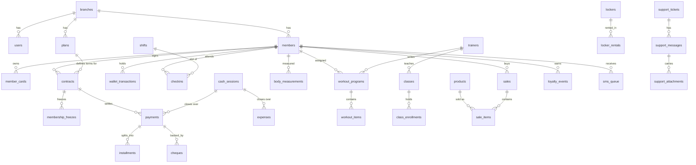

# SCHEMA.md — GymPro

> مرجع: [`packages/db/migrations/0001_init.sql`](../packages/db/migrations/0001_init.sql)
> وضعیت: **تأییدشده با اجرای واقعی** روی SQLite 3.53 — ۴۴ جدول در فایل مایگریشن
> (+ جدول `schema_migrations` که `migrate()` می‌سازد = ۴۵ در دیتابیس زنده)،
> `PRAGMA foreign_key_check` بدون خطا، و شش محدودیت با تست واقعی رد شدند
> (`python scripts/validate-schema.py` → `ALL PASS`).

## قواعد ثابت (نباید نقض شوند)

| قاعده | پیاده‌سازی | دلیل |
|---|---|---|
| کلید اصلی | `id TEXT` = UUIDv7 | مرتب بر اساس زمان، بدون برخورد هنگام سینک، بدون auto-increment |
| پول | `INTEGER` بر حسب **ریال** | هیچ `REAL`/`FLOAT` برای مبلغ؛ خطای گرد کردن صفر |
| زمان | `TEXT` ISO-8601 UTC با میلی‌ثانیه | مقایسه و مرتب‌سازی رشته‌ای = ترتیب زمانی |
| تاریخ کاری (سررسید، پایان قرارداد) | `TEXT` `YYYY-MM-DD` به وقت تهران | «۳۱ شهریور» نباید با تغییر UTC جابه‌جا شود |
| حذف | نرم (`deleted_at`) | حذف فیزیکی ممنوع؛ برای سینک و بازیابی لازم است |
| هم‌روندی | `version INTEGER` در همه جداول دامنه | optimistic concurrency در همه UPDATEها |
| شعبه | `branch_id` در همه جداول دامنه | امروز تک‌شعبه، فردا بدون مایگریشن سنگین |
| تغییر داده | رکورد در `outbox` | Transactional Outbox، همان تراکنش نوشتن |

## نمودار روابط (هسته)

## جداول به تفکیک دامنه

### زیرساخت
| جدول | نقش |
|---|---|
| `schema_migrations` | نسخه و checksum هر مایگریشن؛ اجرا فقط یک‌بار |
| `devices` | این دستگاه و دستگاه‌های شعبه‌های آینده؛ `machine_id`، `is_local` |
| `branches` | شعبه؛ ایندکس یکتا `is_default` تضمین می‌کند فقط یک شعبه پیش‌فرض باشد |
| `settings` | کلید/مقدار به ازای شعبه (PK مرکب) — جای ذخیره‌ی JSON در فایل |

### کاربر و حسابرسی
| جدول | نکته |
|---|---|
| `users` | `role` محدود به چهار نقش؛ `password_hash` bcrypt؛ `pin_hash` جدا؛ `failed_attempts` + `locked_until` ضد Brute-force |
| `login_sessions` | قفل خودکار پس از بی‌کاری، دلیل پایان نشست ثبت می‌شود |
| `audit_logs` | قبل/بعد هر تغییر حساس به‌صورت JSON + دلیل الزامی برای Override |

### عضو
| جدول | نکته |
|---|---|
| `members` | `mobile` یکتا در هر شعبه (ایندکس جزئی روی `deleted_at IS NULL`)؛ `member_no` فقط برای چاپ، PK نیست |
| | `consent_at` = تاریخ اخذ رضایت ثبت داده — برای پاسخ به شکایت لازم است |
| | فیلدهای اختیاری (کد ملی، تاریخ تولد، عکس، آدرس) — حداقل‌سازی داده |
| `member_cards` | **توکن خام QR ذخیره نمی‌شود**، فقط `sha256`؛ ابطال کارت گم‌شده با `status='revoked'` بدون حذف سابقه |

### قرارداد و مالی
| جدول | نکته |
|---|---|
| `plans` | `kind` پنج نوع عضویت؛ `vat_rate_bp` بر حسب «پایهٔ ۱۰۰۰۰» (۹٪ = ۹۰۰) تا درصد اعشاری بدون float ذخیره شود |
| `contracts` | `sessions_total/used` برای عضویت جلسه‌ای؛ `freeze_days_used` برای سقف فریز؛ `list_price` و `discount` جدا تا گزارش تخفیف ممکن باشد |
| `membership_freezes` | `days` ذخیره می‌شود، ولی `end_date` قرارداد هم جابه‌جا می‌شود (منبع حقیقت = قرارداد) |
| `payments` | `receipt_no` یکتا در شعبه؛ باطل‌کردن = `status='void'` نه حذف |
| `installments` | پرداخت جزئی با `paid_amount_irr` و `status='partial'` |
| `cheques` | وضعیت چک مستقل از پرداخت؛ برگشت چک پرداخت را باطل نمی‌کند، علامت می‌زند |
| `wallet_transactions` | `balance_after_irr` ذخیره می‌شود تا هر ردیف مستقل قابل حسابرسی باشد |
| `cash_sessions` | ایندکس یکتا تضمین می‌کند در هر شعبه فقط یک صندوق باز باشد |

### عملیات
`checkins` (چک‌این/اوت، Override با دلیل و تأییدکننده)، `shifts` (سانس با `weekday_mask` بیتی —
هیچ جدول واسط روزهای هفته لازم نیست)، `trainers`, `classes`, `class_enrollments`,
`exercises` (بانک حرکات، قابل اشتراک بین شعبه‌ها)، `workout_programs`/`workout_items`,
`body_measurements`, `products`, `sales`/`sale_items`, `inventory_movements` (تاریخ حرکتی انبار —
موجودی همیشه از جمع حرکات قابل بازسازی است)، `lockers`/`locker_rentals`, `loyalty_events`, `sms_queue`.

### پشتیبانی، لایسنس، آپدیت
| جدول | نکته |
|---|---|
| `support_tickets` | وضعیت طبق اسپک: `draft → queued → sent → answered → closed`؛ `remote_id` بعد از ارسال پر می‌شود |
| `support_messages` | `direction` ورودی/خروجی؛ `is_read` برای نوتیفیکیشن |
| `support_attachments` | فایل در `/data/attachments`، در دیتابیس فقط مسیر نسبی + checksum |
| `license_state` | `license_json` + `signature` جدا نگه داشته می‌شود تا هر بار verify شود؛ `last_seen_at` برای تشخیص عقب‌بردن ساعت |
| `trial_state` | `clock_rollbacks` شمارش می‌شود؛ `members_created` برای سقف ۲۰ عضو |
| `update_history` | مانیفست و امضای آپدیت + وضعیت `rolled_back` |
| `backups` | رکورد بکاپ با checksum (اعتبارسنجی ریستور) |

## آمادگی سینک (بدون نوشتن حتی یک خط کد سینک)

1. **Outbox**: هر `INSERT/UPDATE/DELETE` در همان تراکنش یک ردیف در `outbox` می‌سازد
   (`entity`, `entity_id`, `op`, `payload_json`, `entity_version`, `happened_at`).
   ایندکس یکتا روی `(entity, entity_id, entity_version)` نوشتن تکراری را حذف می‌کند.
2. **Repository**: هیچ کامپوننت UI به SQLite دسترسی ندارد. تنها نقطه نوشتن، `withOutbox()` در
   `packages/db/src/repo/*` است؛ کلید idempotency سینک همین‌جاست.
3. **cursor**: `sync_cursors` نقطهٔ ادامه هر موجودیت را نگه می‌دارد؛ سرور مرکزی هم همین ساختار را دارد.
4. **تصمیم تعارض** (از امروز مستند شده): عضویت، پرداخت و تردد → «برنده = آخرین `happened_at`»؛
   شمارنده‌های مالی (موجودی کیف پول، جلسات مصرف‌شده) → **جمع افزایشی (LWW-reject)**، یعنی از
   رکوردهای رویدادی بازسازی می‌شوند نه از مقدار مطلق. برای همین `wallet_transactions` و
   `inventory_movements` رویدادمحور طراحی شده‌اند و مقدار مطلق فقط برای نمایش/ممیزی است.
5. **شعبه**: `branch_id` از روز اول پر است، پس `WHERE branch_id = ?` امروز فقط یک مقدار دارد و
   فردا صفر تغییر کد لازم است.
