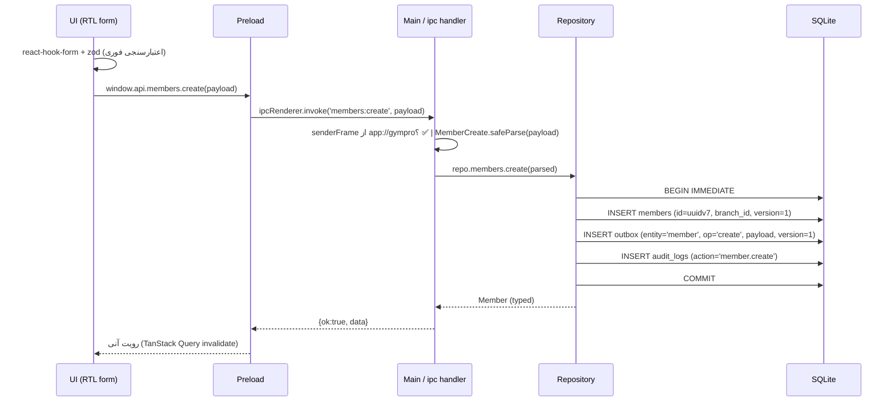

# architecture.md — جریان داده و مرزهای امنیتی

## مدل پروسه‌ها

```
┌─────────────────────────── Electron ───────────────────────────┐
│  Main (Node 24 / Node20 در بیلد)                               │
│   ├─ bootstrap → resolveDataDir() → migrate() → license.verify │
│   ├─ protocol.handle('app://')  → فایل‌های بیلد استاتیک Next    │
│   ├─ BrowserWindow(webPreferences سخت‌گیرانه)                   │
│   ├─ ipcMain.handle('members:create', …)  ← Zod → repo → SQLite │
│   └─ tray / updater / support-poller / backup / logger          │
│                    ▲  contextBridge (لیست سفید)                 │
│                    │                                            │
│  Preload (isolated world)  window.api.members.create(input)     │
│                    ▲                                            │
│  Renderer (Next.js static, app://gympro)                        │
│   هیچ دیتابیس، هیچ فایل، هیچ شبکه — فقط window.api              │
└─────────────────────────────────────────────────────────────────┘
                              │
                        better-sqlite3 (WAL)
                              ▼
                    <dataDir>/gympro.db  (+ -wal, -shm)
```

## جریان یک عملیات نوشتن (مثال: ثبت عضو)



**قاعدهٔ سخت:** در Main هیچ هندلری بدون `safeParse` اجرا نمی‌شود. در Renderer هیچ‌جا
`require`/`fs`/`fetch` به دیتابیس وجود ندارد. `contextIsolation: true`, `sandbox: true`,
`nodeIntegration: false`, `webSecurity: true`.

## بارگذاری امن با `app://`

| تصمیم | مقدار | دلیل |
|---|---|---|
| اسکیم | `app://gympro/` | `file://` به دلیل origin-opaque بودن، CSP و Service Worker و کوکی‌های ایزوله را از بین می‌برد |
| ثبت | `protocol.registerSchemesAsPrivileged([{scheme:'app', privileges:{standard:true, secure:true, supportFetchAPI:true, corsEnabled:false}}])` **قبل از** `app.whenReady()` | `standard` → origin واقعی؛ `secure` → مثل https رفتار می‌کند |
| هندلر | `protocol.handle('app', req => net.fetch(pathToFileURL(resolve(…) ).toString()))` با **path traversal guard** | هر مسیری که پس از resolve بیرون از `renderer/` بیفتد، ۴۰۳ |
| CSP | `default-src 'none'; script-src 'self'; style-src 'self' 'unsafe-inline'; img-src 'self' data:; font-src 'self'; connect-src 'none'; frame-src 'none'` | Renderer به شبکهٔ اینترنت دسترسی ندارد؛ فقط Main شبکه دارد |

`connect-src 'none'` یعنی حتی اگر کسی کد ترکینگ تزریق کند، مرورگر آن را مسدود می‌کند.
این تنها لایهٔ فنی است که «آفلاین بودن» را قابل اثبات می‌کند و به سند حقوقی هم متصل است
(بخش «چه داده‌ای از دستگاه خارج می‌شود» در `legal/privacy-policy.md`).

## مسیر داده (portable-safe)

```
1) if process.env.PORTABLE_EXECUTABLE_DIR  → dataDir = join(dir, 'data')
2) else if app.isPackaged                  → app.getPath('userData')
3) else (dev)                              → join(process.cwd(), '.dev-data')
4) mkdir: data, data/{backups,photos,attachments,logs,updates}
5) write-probe: try { fs.writeFileSync(join(dataDir,'.write-test'),'1'); unlink } catch →
   dataDir = app.getPath('userData');  uiWarning = 'حالت پرتابل: پوشه کنار فایل exe قابل نوشتن نبود…'
6) همهٔ مسیرها با path.join و path.resolve؛ هیچ '/' یا '\\' دستی؛ اسم فایل خروجی با NFD/NFC نرمال
```

نام کاربری و مسیر فارسی/فاصله‌دار پوشش داده می‌شود چون هیچ‌جا مسیر در URL خام interpolate نمی‌شود
(encodeURIComponent + `pathToFileURL`).

## مایگریشن با بکاپ خودکار

```
read schema_migrations → for each pending .sql:
  if db not empty: backup/pre_migration_<ts>.db  (VACUUM INTO)
  BEGIN → executescript(sql) → INSERT schema_migrations(version, sha256(file)) → COMMIT
  on error: rollback + restore from that backup + پیام فارسی (نه استک)
```
`checksum` جلوی «مایگریشن دستکاری‌شده» را می‌گیرد؛ مایگریشنِ اجراشده با checksum متفاوت = خطای سخت.

## IPC — قرارداد تایپ‌شده

منبع واحد: `packages/shared/ipc-contracts.ts`

```ts
export const channels = {
  'members:list':   { input: MemberListQuery, output: Paged<Member> },
  'members:create': { input: MemberCreate,    output: Member },
  'members:update': { input: MemberUpdate,    output: Member },   // MemberUpdate شامل id + version
  'members:delete': { input: IdWithReason,    output: Ok },       // حذف نرم + دلیل
  …
} as const
```
Main با `Map<channel, {schema, handler}>` ثبت می‌کند؛ Preload فقط کلیدهای همین map را
`contextBridge` می‌کند (هیچ `invoke` عمومی، هیچ `ipcRenderer` بیرون‌داده‌شده).
خطاها با کد ثابت (`E_VALIDATION`, `E_NOT_FOUND`, `E_VERSION_CONFLICT`) و پیام فارسی برمی‌گردند.

## لایسنس (خلاصهٔ جریان)

```
machineId = sha256(cpuId | macAddress | diskSerial | localSalt)   // پایدار، تغییر RAM/گرافیک اثر ندارد
license.json = { licenseKey, machineId, edition, issuedAt, updateEntitlementUntil, features[], maxActivations, activationsUsed }
verify: ed25519.verify(canonicalJson(body), signature, PUBLIC_KEY_EMBEDDED)
        && body.machineId === machineId && now() <= clockGuardLimit
clock guard: last_seen_at ذخیره؛ اگر now < last_seen - 6h → status='tampered' + قفل احتیاطی
```
جزئیات کامل در `docs/backends.md` و `docs/risks.md`.

## لاگ و کرش

`data/logs/app-YYYY-MM-DD.log` با چرخش ۷ فایل × ۵MB، سطح `info|warn|error`، **بدون** نوشتن
نام/موبایل عضو در لاگ (redaction در لایهٔ logger: هر مقدار با کلید `mobile|fullName|nationalId`
به `***` تبدیل می‌شود). لاگ هرگز به اینترنت فرستاده نمی‌شود مگر با رضایت صریح («ارسال گزارش خطا»
در صفحهٔ تیکت، با پیش‌نمایش متن قبل از ارسال).
